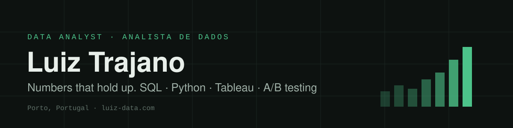

<p align="center">
  
</p>

<p align="center">
  <a href="https://www.luiz-data.com"></a>
</p>

<p align="center">
  <a href="https://www.luiz-data.com"></a>
  <a href="https://www.linkedin.com/in/luiz-antonio-trajano/"></a>
  <a href="https://www.instagram.com/luiz.data/"></a>
  <a href="https://public.tableau.com/views/RecompraOlist-ProjetoFinal/Painel1?:language=pt-BR&:showVizHome=no&:display_count=n&:origin=viz_share_link"></a>
</p>

<p align="center">
  
  
  
  
</p>


## About me

```python
luiz = {
    "role":       "Data Analyst",
    "based_in":   "Porto, Portugal",
    "certified":  "TripleTen Data Analyst (2026)",
    "stack":      ["SQL", "Python", "pandas", "SciPy", "scikit-learn", "Tableau"],
    "loves":      ["cohorts", "A/B tests", "funnels", "churn", "repurchase"],
    "background": ["Systems Development diploma", "logistics at Lidl Portugal", "semi-pro basketball"],
    "speaks":     ["Portuguese", "English"],
    "next_up":    ["Excel certification", "Power BI"],
}
```

I turn raw data into decisions. In my final project I asked why only **2.01%** of 58,139 Olist first-time buyers came back within 180 days, and found that a late first delivery turns **75.63%** of ratings into 1 to 3, against 18.17% on time. Every project I publish ends in a recommendation someone can act on, and every number in it is checked in the notebook.

<sub>🇵🇹 Analista de dados no Porto. Dez projetos públicos do programa Data Analyst da TripleTen, do notebook ao dashboard. Aberto a vagas no Porto e em remoto.</sub>

## How I work


## Tools

<p>
  
</p>
<p>
  
  
  
  
  
  
  
  
  
  
</p>

<details>
<summary><b>Methods I have used in real projects</b></summary>

<br>

| Area | Methods |
|---|---|
| Statistics | Welch and Student t-tests, Mann-Whitney U, chi-square, z-tests for proportions, Holm and Bonferroni corrections, statistical power, 95% intervals |
| Product and marketing | Cohort analysis, LTV, CAC, ROMI, DAU/WAU/MAU, retention, sales funnels, A/A/B tests, ICE and RICE prioritisation |
| Machine learning | Logistic regression, random forest, stratified splits, precision and recall, leakage tests, K-Means with dendrogram and silhouette |
| SQL | CTEs, window functions (RANK, SUM OVER), joins with integrity checks |
| Data collection | Web scraping with requests and BeautifulSoup |

</details>

## Featured projects

| | Project | What it found | Stack |
|:-:|---|---|---|
| 🛒 | [**Customer repurchase at Olist**](https://github.com/luiz19190/Sprint-14-Projeto-final) · [live dashboard](https://public.tableau.com/views/RecompraOlist-ProjetoFinal/Painel1?:language=pt-BR&:showVizHome=no&:display_count=n&:origin=viz_share_link) | 2.01% of 58,139 first-time buyers return in 180 days; late delivery drives low ratings; five hypotheses with Holm and power | Python · SciPy · Tableau |
| 🧪 | [**A/B test and SQL**](https://github.com/luiz19190/Sprint-14-Projeto-final) | A recommender below control at every funnel step; a five-table SQL analysis with CTEs and window functions | SQL · Python |
| 🏋️ | [**Gym churn prediction**](https://github.com/luiz19190/Sprint-13-Churn-model-fitness) | The model finds 83.0% of the customers who leave; five segments with churn from 2.2% to 52.6% | scikit-learn · pandas |
| 📺 | [**Trending YouTube dashboard**](https://github.com/luiz19190/Sprint-12-Dashboard-YouTube-Tableau) · [live dashboard](https://public.tableau.com/views/VdeosemaltanoYouTubeSterlingDraperSprint12/DashboarddeApresentao) | 12,343 daily records in 5 countries, and the three data caveats that change how it reads | Tableau · pandas |
| 🔻 | [**Sales funnel and A/A/B test**](https://github.com/luiz19190/Sprint-11-Projeto-integrado-2) | Where an app loses users on the way to payment, from 240,887 events; 20 z-tests with Bonferroni | Python · SciPy |
| ⚖️ | [**Business decisions (A/B)**](https://github.com/luiz19190/Sprint-9-Tomando-decisoes-de-negocios) | One US$19,920.40 order created the average-order lift; only conversion held (+16.0%) | pandas · SciPy |

<p align="center"><a href="https://www.luiz-data.com"><b>All ten case studies, in English and Portuguese → luiz-data.com</b></a></p>

## GitHub in numbers

<p align="center">
  
  
</p>
<p align="center">
  
</p>
<p align="center">
  
</p>

<picture>
  <source media="(prefers-color-scheme: dark)" srcset="https://raw.githubusercontent.com/luiz19190/luiz19190/output/snake-dark.svg">
  
</picture>

<p align="center"><sub>Porto, Portugal · <a href="https://www.luiz-data.com">luiz-data.com</a> · Open to Data Analyst and BI roles</sub></p>
